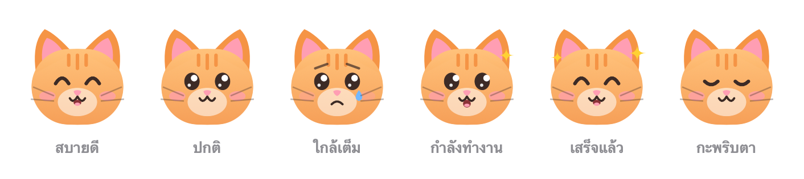

<div align="center">

# Purr 🐱

**แมวน้อยบน menu bar ที่ช่วยดูแลเครื่อง Mac ของคุณ**

ล้างแคช, optimize ระบบ, ดู CPU / แรม / ดิสก์ — ทั้งหมดแค่คลิกเดียว



</div>

---

Purr คือหน้าตาแบบกดง่ายๆ (GUI) ที่ครอบ [Mole](https://github.com/tw93/mole) — เครื่องมือ command line ทำความสะอาด Mac ชื่อดัง
แทนที่จะต้องจำคำสั่ง `mo clean`, `mo optimize` ฯลฯ ก็แค่กดที่แมวบนแถบเมนูด้านบนของจอ

> Purr เป็นโปรเจกต์ส่วนตัว ไม่ได้เกี่ยวข้องหรือได้รับการรับรองจากทีม Mole — Purr แค่ไปเรียกใช้ `mo` ที่คุณติดตั้งไว้ในเครื่องเท่านั้น

## ✨ ทำอะไรได้บ้าง

| | สิ่งที่เห็น / ปุ่ม | คำสั่งที่รันจริง | หมายเหตุ |
|---|---|---|---|
| 🐱 | หน้าแมว + คะแนนสุขภาพ | – | อารมณ์เปลี่ยนตามสภาพเครื่อง คลิกเพื่อลูบหัวได้ |
| 📊 | CPU / แรม / ดิสก์ว่าง | – | อัปเดตทุก 2 วินาที |
| 👃 | **ดมก่อน** | `mo clean --dry-run` | ดูอย่างเดียว ไม่ลบอะไร |
| 🧹 | **เลียขน** | `mo clean` | ลบแคช/ล็อก/ถังขยะ **ถาวร** (ถามยืนยันก่อน) |
| 🧘 | **ยืดเส้น** | `mo optimize` | รีเฟรช DNS, QuickLook, ไอคอน ฯลฯ (ถามยืนยันก่อน) |
| 📦 | **คุ้ยโปรเจกต์** | `mo purge --dry-run` | หา `node_modules`, `build`, `dist` ที่ลบได้ |
| 🗑️ | ถอนแอป | `mo uninstall` | เปิดใน Terminal |
| 🔎 | สำรวจดิสก์ | `mo analyze` | เปิดใน Terminal |
| 💿 | ไฟล์ติดตั้ง | `mo installer` | เปิดใน Terminal |
| 📜 | ประวัติ | `mo history` | เปิดใน Terminal |

งานในกลุ่ม "งานแมว" รันในแอปและแสดง log สดๆ (กดหยุดได้) ส่วนงานที่ต้องเลือกรายการด้วยคีย์บอร์ดจะเปิดหน้าต่าง Terminal ให้

## 📋 สิ่งที่ต้องมี

- **macOS 14 (Sonoma) ขึ้นไป**
- **Swift 5.9+** — มากับ Xcode หรือ Command Line Tools
- **Mole** (`mo`)

## 🚀 ติดตั้ง (ประมาณ 3 นาที)

**1. ติดตั้ง Command Line Tools** (ข้ามได้ถ้ามี Xcode หรือเคยติดตั้งแล้ว)

```bash
xcode-select --install
```

เช็กว่าพร้อมแล้ว: `swift --version` ต้องขึ้นเลขเวอร์ชัน

**2. ติดตั้ง Mole**

```bash
brew install mole
```

ยังไม่มี Homebrew? ติดตั้งจาก [brew.sh](https://brew.sh) ก่อน หรือใช้สคริปต์ของ Mole:
`curl -fsSL https://raw.githubusercontent.com/tw93/mole/main/install.sh | bash`

เช็กว่าพร้อมแล้ว: `mo --version`

**3. โหลดและ build Purr**

```bash
git clone https://github.com/mobbenxd/purr.git
cd purr
./build.sh
```

ครั้งแรกใช้เวลาราว 1 นาที เสร็จแล้วจะได้ `Purr.app` ในโฟลเดอร์นี้

**4. ย้ายไป Applications แล้วเปิด**

```bash
mv Purr.app /Applications/
open /Applications/Purr.app
```

จะเห็นหน้าแมว 🐱 ที่แถบเมนูด้านบนขวาของจอ (Purr ไม่มีไอคอนใน Dock) — คลิกเลย!

**5. (ไม่บังคับ) ให้เปิดเองทุกครั้งที่เข้าเครื่อง**

System Settings → General → Login Items → กด **+** → เลือก `Purr`

## 🔄 อัปเดตเป็นเวอร์ชันใหม่

```bash
cd purr
git pull
./build.sh
pkill -x Purr; rm -rf /Applications/Purr.app && mv Purr.app /Applications/ && open /Applications/Purr.app
```

## 🧹 ถอนการติดตั้ง

ออกจากแอป (คลิกแมว → **ออก**) แล้วลบ `/Applications/Purr.app` ได้เลย Purr ไม่ได้เก็บไฟล์อื่นไว้ในเครื่อง

## 🛟 ความปลอดภัย

- เริ่มจาก **👃 ดมก่อน** เสมอ เพื่อดูว่าจะลบอะไรบ้าง รายการเต็มอยู่ที่ `~/.config/mole/clean-list.txt`
- **🧹 เลียขน** ลบถาวร ไม่ผ่านถังขยะ ถ้ามีแคชที่อยากเก็บไว้ ให้ตั้งค่าด้วย `mo clean --whitelist` ใน Terminal
- เวลารันจากในแอป Mole จะล้างเฉพาะส่วนของผู้ใช้ แคชระดับระบบที่ต้องใช้รหัสผ่าน admin จะถูกข้าม (ถ้าอยากล้างด้วย ให้รัน `mo clean` ใน Terminal)
- ดูประวัติสิ่งที่ถูกลบได้จากปุ่ม **📜 ประวัติ**

## ❓ แก้ปัญหา

<details>
<summary><b>แมวขึ้นว่า "หา <code>mo</code> ไม่เจอ"</b></summary>

Purr หา `mo` ใน `/opt/homebrew/bin`, `/usr/local/bin`, `~/.local/bin` และ `/run/current-system/sw/bin`
ติดตั้ง Mole ตามขั้นตอนที่ 2 แล้วปิด-เปิด Purr ใหม่ ถ้าติดตั้งไว้ที่อื่น เช็กด้วย `which mo`
</details>

<details>
<summary><b><code>./build.sh</code> ขึ้น error <code>swift: command not found</code> หรือ <code>xcrun: error</code></b></summary>

ติดตั้ง Command Line Tools ตามขั้นตอนที่ 1 ถ้ามี Xcode อยู่แล้วแต่ยัง error ลอง
`sudo xcode-select --switch /Applications/Xcode.app`
</details>

<details>
<summary><b><code>./build.sh</code> ขึ้น <code>permission denied</code></b></summary>

```bash
chmod +x build.sh
```
</details>

<details>
<summary><b>กดปุ่มกลุ่ม "เปิดใน Terminal" แล้วไม่มีอะไรเกิดขึ้น</b></summary>

Purr สร้างไฟล์ `.command` แล้วให้ macOS เปิดด้วยแอป Terminal ถ้า macOS ถามสิทธิ์ ให้กดอนุญาต
หรือถ้าเคยตั้งให้ไฟล์ `.command` เปิดด้วยแอปอื่น ให้คลิกขวาไฟล์ `.command` ใดๆ → Get Info → Open with → Terminal
</details>

<details>
<summary><b>หาแมวบน menu bar ไม่เจอ</b></summary>

ถ้า menu bar มีไอคอนเยอะเกินไป (โดยเฉพาะ MacBook ที่มีรอยบาก) ไอคอนอาจถูกซ่อน ลองซ่อนไอคอนอื่นด้วยการกด ⌘ ค้างแล้วลากออก
</details>

## 🛠 สำหรับนักพัฒนา

```
Sources/Purr/
├── PurrApp.swift      # จุดเริ่มแอป: MenuBarExtra + ไอคอนแมว
├── PurrPanel.swift    # หน้าตาแผง: หัวแมว, ตัวเลขเครื่อง, ปุ่ม, log
├── CatFace.swift      # วาดหน้าแมว 6 อารมณ์ด้วย Canvas (ไม่ใช้ไฟล์รูป)
├── PurrModel.swift    # รายการงาน + การรัน `mo` และอ่าน output
└── SystemStats.swift  # อ่าน CPU / แรม / ดิสก์ จาก macOS โดยตรง
```

- รันแบบ debug: `swift run`
- เพิ่ม/แก้ปุ่ม: แก้ `CatTasks` ใน `PurrModel.swift`
- เปลี่ยนสีขนแมว: แก้ `fur`, `furDark`, `pink` ใน `CatFace.swift`

## 🙏 ขอบคุณ

- [Mole](https://github.com/tw93/mole) โดย [@tw93](https://github.com/tw93) — เครื่องมือที่ทำงานจริงอยู่เบื้องหลังทุกปุ่ม
